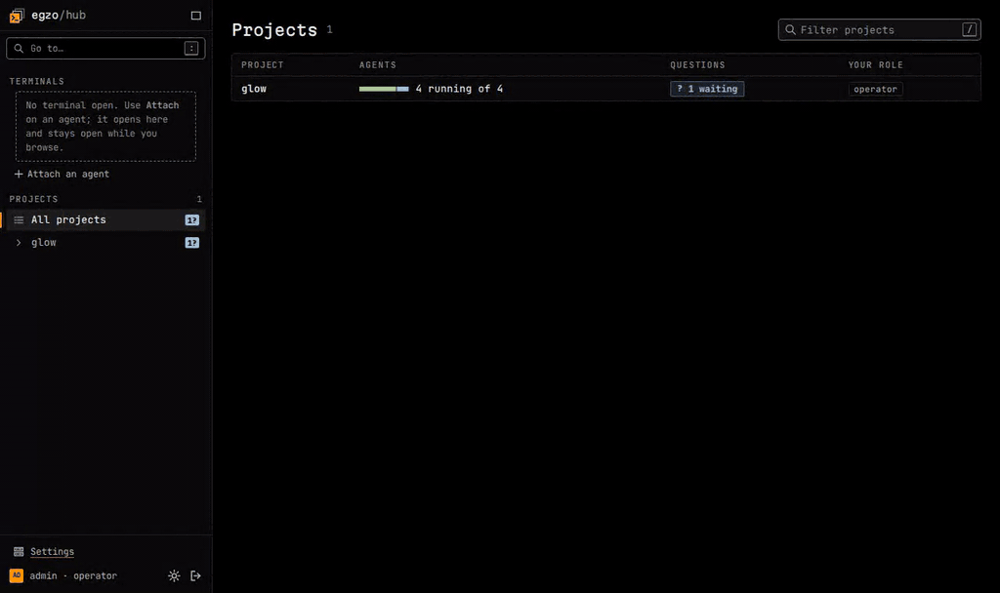

# egzo: simple agent sandboxing and orchestration

> [!NOTE]
> **Project status:** egzo is in active development. Expect some breaking changes as we work toward a 1.0 release.
> The core CLI tool and web UI are stable enough for testing and non-production work.
> See [the 1.0 roadmap](roadmap/initial-release.md) for details.



Egzo is a CLI tool to sandbox coding agents and organize your projects, with an optional [web UI](docs/hub.md),
to watch and drive them from a browser.

A project is one YAML file: the files and services you are working on, and the agents you want to use.

I built it to stop wondering what each of my agents has access to. No web forms with dozens of options, no complex state
kept in databases and daemons. Just a short project file that you apply with `egzo project up`, and your container engine
does the rest.

## Features

- **Claude Code and OpenCode.** More harnesses planned.
- **[Real TUIs](docs/managing-projects.md).** The harness's own interface, in your terminal or in the web UI.
- **[Templates and instances](docs/project-file.md).** Declare an agent once, spawn as many instances as you need, each with its
  own container, network and workspace.
- **[Isolation by default](docs/security.md).** List the files your agents can reach.
- **[gVisor and rootless Podman](docs/install.md#pick-an-engine).** Supported and tested, for additional security.
- **[Built-in HTTPS and SSH proxy](docs/sandboxing.md).** List the services your agents can reach, everything else is denied by default.
- **[Credential injection](docs/security.md#how-secret-injection-works).** Agents can't leak passwords and tokens they don't have access to.
- **[Secrets](docs/project-file.md#vaults-and-secrets).** Read from `pass` or environment variables. More password managers planned.
- **[Git integration](docs/workspaces.md).** Git worktrees and multiple repos per agent are supported.
- **[Messaging](docs/messaging.md).** User to agent, agent to agent and agent to user. External bridges (Discord) in the works.
- **[Built-in browser](docs/browser.md).** Batteries included with Chromium and the Playwright MCP pre-installed in our default
  harness images.
- **[Your own tools](docs/images.md).** Add software to a harness image, or run any image with the `custom` harness.
- **[The hub](docs/hub.md).** A web UI: every project and agent, terminals in the browser, single sign-on and per-project roles.

## Supported platforms

Egzo needs a working Docker or Podman engine.

The following platforms are tested for each new release and using nightly GitHub Actions:

- Docker engine on Linux (amd64 and arm64)
- Rootless Podman on Linux
- Docker with [gVisor](docs/install.md#using-gvisor)

Work in progress:

- Rootful Podman has a minor issue: [`known-issues/rootful-podman-intermittent-egress.md`](known-issues/rootful-podman-intermittent-egress.md).
- macOS and Windows (through WSL2) are untested: [`roadmap/windows-and-macos.md`](roadmap/windows-and-macos.md).

See [Installation](docs/install.md) for more details.

## Documentation

See [`docs/`](docs/README.md): the CLI and the project file, then [the hub](docs/hub.md), the web UI.

## Example: architect with Claude, code with OpenCode

A GitHub repo and two agents.

```yaml
# egzo.yaml
vaults:
  main:
    backend: env
    secrets: [ANTHROPIC_API_KEY, GITHUB_TOKEN]

egress:
  default:                           # one profile for everyone; anything not allowed is denied
    allow: [platform.claude.com]
    services:
      anthropic: main/ANTHROPIC_API_KEY
      github: main/GITHUB_TOKEN

workspaces:
  repo:
    git: { url: https://github.com/egzo-ai/egzo.git, branch: main }

agents:
  architect:
    harness: claude-code
    workspaces: [repo]
    prompt: ./prompts/architect.md   # "You are a senior software architect..."

  coder:
    harness: opencode
    workspaces: [repo]
    prompt: ./prompts/coder.md       # "Make no mistake"
```

Each `agents:` entry is a template: `egzo project up` starts the infra, `egzo agent spawn` starts a throwaway agent.

```console
$ export ANTHROPIC_API_KEY=... GITHUB_TOKEN=...
$ egzo project up                                     # the proxy, the control sidecar, the templates
$ egzo agent spawn architect -m "I want to build my own agent orchestration system"
$ egzo agent spawn coder issue-123 -m "Start work on the oldest backlog item" --attach
$ egzo ps
NAME             SERVICE    STATE    HEALTH   ACTIVITY  OPEN  WAITING  ACTOR     AGE  STALE  STATUS
architect-1      architect  running           working   1              operator  2m
issue-123        coder      running           working   1              operator  1m
myapp-control-1  control    running  healthy                                     3m
myapp-proxy-1    proxy      running  healthy                                     3m

$ egzo agent attach architect-1  # the real Claude Code TUI; detach with Ctrl-]
$ egzo agent spawn coder review-123 -m "Review the new PR" --wait    # waits for the answer, exits 0 when done
$ egzo agent rm review-123
```

## License

Copyright (C) Neopeak Internet Solutions inc. egzo is licensed under the [GNU Affero General Public License v3.0](LICENSE) (`AGPL-3.0-only`).
