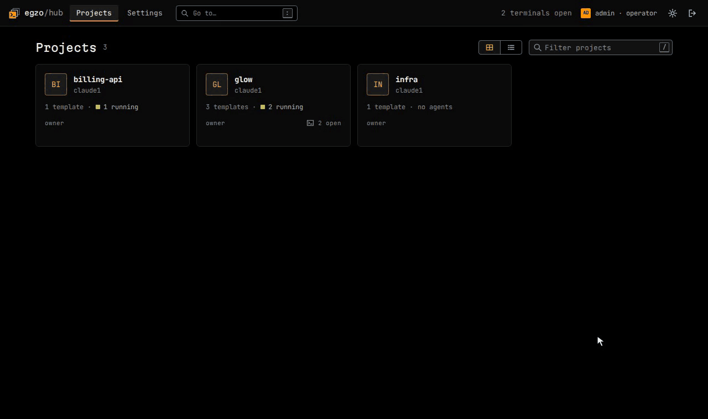
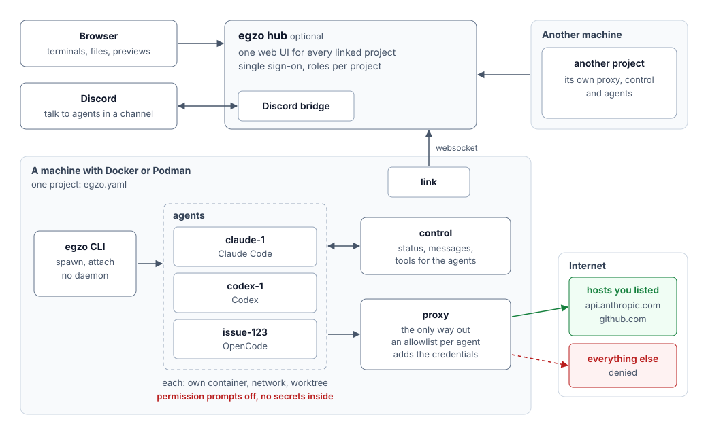

# egzo: simple agent sandboxing and orchestration

[](https://github.com/egzo-ai/egzo/actions/workflows/specs.yml)
[](https://github.com/egzo-ai/egzo/actions/workflows/ci.yml)
[](https://github.com/egzo-ai/egzo/releases)
[](LICENSE)

> [!NOTE]
> **Project status:** egzo is in active development. Expect some breaking changes as we work toward a 1.0 release.
> The core CLI tool and web UI are stable enough for testing and non-production work.
> See [the 1.0.0 milestone](https://github.com/egzo-ai/egzo/milestone/1) for details.

> [!NOTE]
> Egzo 0.16.0 is out, and the [Discord integration](docs/hub-bridges.md#discord) is included as a feature preview. We are
> nearing feature completion for 1.0.
> [I am looking for beta testers!](https://github.com/egzo-ai/egzo/discussions/209)



Egzo is a CLI tool to sandbox coding agents and organize your projects, with an optional [web UI](docs/hub.md),
to watch and drive them from a browser.

A project is one YAML file: the files and services you are working on, and the agents you want to use.

I built it to stop wondering what each of my agents has access to. No web forms with dozens of options, no complex state
kept in databases and daemons. Just a short project file that you apply with `egzo project up`, and your container engine
does the rest.

## How it works



Egzo isolates agents in standard containers, with all file and network access denied by default. Network access goes
through a built-in proxy that injects the credentials. Services, allowed hosts and file access are configured in a short
YAML project file.

Projects can live on different machines and connect out to a central hub over a WebSocket. There you control every agent,
[link your Discord account](docs/hub-bridges.md#discord) to chat with them, and [invite other people](docs/hub-access.md#invites)
to collaborate on your projects.

Agents can expose [TCP/UDP ports on your LAN](docs/project-file.md#local-ports), so you can reach the Minecraft mod or game server
your agent is working on. You can also use [web previews](docs/hub.md#previews) to securely access any web app it is working on,
through the hub.

## Features

- **Claude Code, OpenCode and Codex.** More harnesses planned.
- **[Real TUIs](docs/managing-projects.md).** The harness's own interface, in your terminal or in the web UI.
- **[Templates and instances](docs/project-file.md).** Declare an agent once, spawn as many instances as you need, each with its
  own container, network and workspace.
- **[Isolation by default](docs/security.md).** List the files your agents can reach.
- **[gVisor, sysbox and rootless Podman](docs/install.md#pick-an-engine).** Supported, for additional security.
- **[Built-in HTTPS and SSH proxy](docs/sandboxing.md).** List the services your agents can reach, everything else is denied by default.
- **[Credential injection](docs/security.md#how-secret-injection-works).** Agents can't leak passwords and tokens they don't have access to.
- **[Secrets](docs/project-file.md#vaults-and-secrets).** Read from `pass`, environment variables or a `.env` file. More password managers planned.
- **[Git integration](docs/workspaces.md).** Git worktrees and multiple repos per agent are supported.
- **[Messaging](docs/messaging.md).** User to agent, agent to agent and agent to user. From [Discord](docs/hub-bridges.md#discord) too, through the hub.
- **[Built-in browser](docs/browser.md).** Batteries included with Chromium and the Playwright MCP pre-installed in our default
  harness images.
- **[Your own tools](docs/images.md).** Add software to a harness image, or run any image with the `custom` harness.
- **[Ports](docs/project-file.md#ports).** Declare the ports an agent may serve. It opens one when you need it, on your machine or through the hub.
- **[The hub](docs/hub.md).** A web UI: every project and agent, terminals in the browser, previews of what agents build, single sign-on and per-project roles.

## Quick start

Install the binary (Linux, amd64; `egzo-linux-arm64` for arm64):

```console
$ curl -fsSLO https://github.com/egzo-ai/egzo/releases/latest/download/egzo-linux-amd64
$ install -m 0755 egzo-linux-amd64 ~/.local/bin/egzo
```

In a clone of your repository:

```console
$ egzo project init                   # writes egzo.yaml: one Claude Code agent, your repo as its workspace; the secret key in .env
$ egzo project up
$ egzo agent spawn claude --attach    # Claude Code in a sandbox: sign in normally with /login; Ctrl-] detaches
```

Sign in once with your Claude subscription: the proxy keeps the sign-in, and every agent after the first starts signed in.
An API key or a `claude setup-token` token works too ([Claude Code](docs/harnesses.md#claude-code)). To clone a private
repo or push, give the agent a GitHub token: the `github` service ([workspaces](docs/workspaces.md)).

## Web UI

The hub runs as one container, and your projects link to it. See [the hub](docs/hub.md) to set it up.

## Example: architect with Claude, code with OpenCode

A GitHub repo and two agents.

```yaml
# egzo.yaml
secret_key: env/EGZO_PROJECT_SECRET_KEY    # seals what egzo keeps at rest: `openssl rand -hex 32`
egress:
  default:                           # one profile for everyone; anything not allowed is denied
    allow: [platform.claude.com]
    services:
      anthropic: env/ANTHROPIC_API_KEY
      github: env/GITHUB_TOKEN

workspaces:
  repo:
    git: { url: https://github.com/egzo-ai/egzo.git, branch: main }

agents:
  architect:
    harness: claude-code
    workspaces: [repo]
    prompt: ./prompts/architect.md   # "You are a senior software architect..."

  coder:
    harness: opencode
    workspaces: [repo]
    prompt: ./prompts/coder.md       # "Make no mistake"
```

Each `agents:` entry is a template: `egzo project up` starts the infra, `egzo agent spawn` starts a throwaway agent.

```console
$ export ANTHROPIC_API_KEY=... GITHUB_TOKEN=...
$ egzo project up                                     # the proxy, the control sidecar, the templates
$ egzo agent spawn architect -m "I want to build my own agent orchestration system"
$ egzo agent spawn coder issue-123 -m "Start work on the oldest backlog item" --attach
$ egzo ps
NAME             SERVICE    STATE    HEALTH   ACTIVITY  OPEN  WAITING  ACTOR     AGE  STALE  PORTS  STATUS
architect-1      architect  running           working   1              operator  2m
issue-123        coder      running           working   1              operator  1m
myapp-control-1  control    running  healthy                                     3m
myapp-proxy-1    proxy      running  healthy                                     3m

$ egzo agent attach architect-1  # the real Claude Code TUI; detach with Ctrl-]
$ egzo agent spawn coder review-123 -m "Review the new PR" --wait    # waits for the answer, exits 0 when done
$ egzo agent rm review-123
```

## Similar projects

I am aware of similar projects and took inspiration from some of them. [Scion](https://googlecloudplatform.github.io/scion/) was the
main inspiration, and this is what I wanted to improve:

- [declarative projects](docs/project-file.md) in a single config file, with no REST API or database to configure them.
- [network and file isolation](docs/security.md) (sandbox), with [secret injection](docs/security.md#how-secret-injection-works)
  through the proxy.
- easily authenticate agents with [Claude](docs/harnesses.md#claude-code) and [ChatGPT](docs/harnesses.md#codex) subscriptions, or an
  [OpenCode Go](docs/harnesses.md#getting-the-key-for-an-opencode-go-subscription) key. Log in once for the subscriptions; the proxy
  keeps the sign-in, and every agent after the first starts signed in.
- explore enhanced container security using [gVisor](docs/gvisor.md), [rootless Podman](docs/podman.md) and
  [sysbox](docs/sysbox.md).

| | **egzo** | **Docker sbx** | **Claude Code (bubblewrap)** | **NVIDIA OpenShell** | **Scion** |
|---|---|---|---|---|---|
| **Config lives in** | one `egzo.yaml` | `sbxenv.yaml` (experimental) + `sbx policy` | `settings.json` files | policy YAML + gateway state | Hub database (UI, API, CLI) |
| **Isolation** | container | microVM | shell commands only | container, kernel rules | container |
| **Network** | denied by default | a preset you pick | allowlist | denied by default | open by default |
| **Credentials** | kept in the proxy | kept in the proxy | in the agent by default | kept out of the agent | given to the agent |
| **Your files** | not mounted | mounted by default | used in place | the paths you declare | worktree or clone |
| **Web UI, chat** | yes | no | no | no | yes |
| **License** | AGPL-3.0-only | proprietary | Apache-2.0 (sandbox part) | Apache-2.0 | Apache-2.0 |

Docker sbx and OpenShell are sandboxes, and Scion is an orchestration platform. Egzo does both.

## Supported platforms

Egzo needs a working Docker or Podman engine.

The following platforms are tested for each new release and using nightly GitHub Actions:

- Docker engine on Linux (amd64 and arm64)
- Rootless Podman on Linux
- Docker with [gVisor](docs/install.md#using-gvisor)
- Docker with [sysbox](docs/install.md#using-sysbox)

Work in progress:

- Rootful Podman has a minor issue: [Using Podman](docs/podman.md).
- macOS and Windows (through WSL2) are untested: [#147](https://github.com/egzo-ai/egzo/issues/147).

See [Installation](docs/install.md) for more details.

## Documentation

See [`docs/`](docs/README.md): the CLI and the project file, then [the hub](docs/hub.md), the web UI.

## License

Copyright (C) Neopeak Internet Solutions inc. egzo is licensed under the [GNU Affero General Public License v3.0](LICENSE) (`AGPL-3.0-only`).
