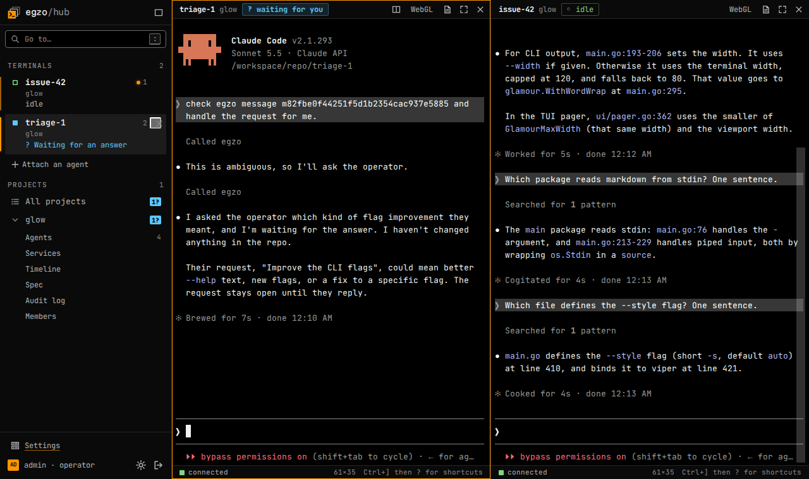

# The hub

The hub is a web UI over the egzo projects of one or more container engines. It shows what runs and what each agent is doing,
lets people spawn, start, stop, remove and attach to agents (the agent's real TUI, in a terminal in the browser), and decides
who may do what. It is optional and separate from the CLI: a container of its own (`ghcr.io/egzo-ai/egzo-hub`), which reads
the engines like `egzo` does, so a project made with the CLI shows up in it and an agent spawned in it shows up in `egzo ps`.

A spawn runs in the background and is listed in the project's agents until it has ended. One that failed stays there with why
(a name or a git branch that already exists, for instance) until whoever may operate its agent dismisses it with its trash icon,
or the hub restarts.



It does not create or change projects: the project file and the `egzo` CLI stay the only way to do that (`egzo project up`,
secrets, recreate). This page is how to run it; [sign-in and roles](hub-access.md) is who may do what, and [the hub
API](hub-api.md) is what the web app talks to. The design and its reasons are in [roadmap/hub.md](../roadmap/hub.md).

## Quick start

On the machine that runs your agents, with Docker and its compose plugin:

```sh
mkdir egzo-hub && cd egzo-hub
curl -fsSLO https://raw.githubusercontent.com/egzo-ai/egzo/main/hub/compose.yaml
cat > .env <<EOF
EGZO_SECRET_KEY=$(openssl rand -hex 32)
DOCKER_GID=$(stat -c %g /var/run/docker.sock)
EOF
cat .env                        # review the settings before starting
docker compose up -d
docker compose logs hub         # the password of the starter account, admin, printed once
```

`.env` holds the hub's settings ([Settings](#settings)); the other ones are listed, commented, in
[`hub/.env.example`](../hub/.env.example). Keep `EGZO_SECRET_KEY`: it encrypts the engine credentials the hub stores, and a new key
means entering them again. Set `EGZO_HUB_VERSION` in `.env` to a release (`0.9.0`) to pin the image; the default is `latest`.

Open <http://localhost:8080> and sign in as `admin` with that password ([the starter account](hub-access.md#the-starter-account)).
`admin` is an operator, who holds every project the hub finds. Create a project with the CLI as usual (`egzo project up`) and it
shows up within a second or two.

> **The quick start mounts the Docker socket into the hub.** That is root-equivalent on the host: anyone who controls the hub
> controls the machine. Prefer a rootless engine, or an ssh engine on another machine ([Engines](#engines)), for anything but a
> trial.

## Reaching it

One container, one port, one volume. The hub is meant for a private network (a LAN, Tailscale, a tunnel), not the open internet.
When a reverse proxy is in front, set `EGZO_PUBLIC_URL` and `EGZO_TRUSTED_PROXIES` so the redirects and cookies use the right
address and scheme (cookies are `Secure` when the address is https).

## Signing in

`admin`, the starter account, signs in with a password. For a team, connect your OpenID Connect provider (Keycloak, Authentik,
Google, Entra ID...): people sign in there, and an owner gives each a role on a project. See [sign-in and roles](hub-access.md).

## The terminal

Whoever may operate an agent can open its terminal (**Attach**); there is no read-only view. One person holds it at a time, and the
agent page says who. Opening it while somebody else does offers **Take over**, which ends their terminal ("taken over by ...") and
gives it to you ("Take it back" does the same the other way). Anyone who may open it may take it over. The terminal is sized to
the pane that shows it.

You can have several terminals open at once, across projects and engines. They are listed in the sidebar, stay connected while
you browse the pages, come back after a reload (the agent's session lives on the engine), and can be shown one at a time, side by
side, or four to a screen. Closing one detaches; the agent keeps running. Up to 12 can be open.

Keys inside a terminal belong to the agent, with one exception: **Ctrl+]** is the leader, and the key after it is the hub's
(`1`-`9` go to a terminal, `s` changes the layout, `f` is full screen, `d` closes, `?` lists them all). The browser keeps a few
chords for itself (Ctrl+W, Ctrl+T, Ctrl+N): a page cannot take them, so they act on the browser tab and never reach the agent. On
pages, `:` or Ctrl+K opens the command menu; single-key shortcuts can be turned off in the shortcut reference.

### Known issue: the CLI

The hub only knows the terminals it opened. `egzo agent attach` goes straight to the agent's session and the hub neither sees it nor can
end it. Attaching with the CLI to an agent that is open in the hub is risky: the session has one screen size, so each side's window
resize changes it for the other, and what both type reaches the program. Avoid it. Nothing in the hub prevents it.

## Network

When an agent cannot reach something, the **Network** tab of its page (and of the project page, for every agent, also in the
sidebar) says what the proxy refused, why, and how to fix it. An agent that was refused a host in the last hour shows **N denied** in the agents list.

- **Denied** groups what the proxy refused or failed at by agent, host and reason, with how many times and when it was last
  seen. Wrong proxy credentials are grouped by the name they claimed, shown with `?`; **How to fix** says where the latest one
  came from. **How to fix** says what the reason means and what to change: for a host that is not in the profile, the YAML to add to
  that profile in `egzo.yaml`, then `egzo project up`. The hub never changes the project file. When several hosts under one
  domain were refused, it says which wildcard covers them. A group is marked **fixed** once the same agent gets through to the
  host, and opens again at the next refusal.
- **Connections** are the latest the hub heard, one row per connection: the host, how it was handled (tunnel, inject, inspect,
  intercept), its requests, the decision and the traffic. A row opens on its steps, with the address it came from and what the
  client says it is (`curl/8.11.1`, Chrome's user agent, an ssh client's version). The agent is shown only when the proxy
  credentials proved it; a connection with wrong ones shows the name it claimed, marked with `?`. Filters keep the refused ones,
  a host or an agent.

A user sees the network of the agents they may operate; administrators see every agent's, and the refusals the proxy could not
tie to an agent (wrong credentials). An agent whose name comes back is another instance and starts with an empty history.

The denials are kept in the hub's database for 30 days after they were last seen, at most 500 per project. The connections are
the hub's latest 1000 events of the project, in memory; further back, `egzo proxy log` reads the proxy's own log, as far as the
engine keeps it. The schema of the audit trail is in [sandboxing agents](sandboxing.md#see-what-happened).

## Engines

Engines are added in the UI by an operator (**Settings, Engines**), not in the compose file. The connection is tested before it is saved.

| Address | Notes |
|---|---|
| `unix:///var/run/docker.sock` | the engine of the quick start (seeded as `local`). Rootless Podman: its own socket |
| `tcp://host:2376` | with TLS: paste the CA, the client certificate and key. Without TLS the traffic is clear text |
| `ssh://user@host[/path/to/docker.sock]` | with a private key (no passphrase). The server's host key is shown once and pinned; a changed key is refused |

Credentials are encrypted in the database with `EGZO_SECRET_KEY`, are never shown again, and a blank field on an edit keeps what is
stored. Losing the key means entering the credentials again. One unreachable engine is reported and the others keep working.

## How the hub keeps up

The hub does not poll the engines. It reads streams that the engines push, and lists the containers only when they say something changed:

- **The status feed.** The control sidecar of every project writes the agents' status to its log, as JSON lines on standard output (a line
  when something changes, and one every 30 seconds). The hub follows that log through the engine's log API, one stream per project,
  and what the sidebar, Home and the project pages show an agent doing (working, idle, blocked, waiting on a question, its status
  line) is the newest line. It runs no command in the sidecar for it.
- **The audit trail.** The proxy of every project writes its audit trail to its log the same way, and the hub follows it the
  same way, for the **Network** tab. After a restart it reads again from the time of the last event it handled.
- **The engine's events.** The hub watches the engine's event stream for the containers of egzo projects. When one is made,
  started, stopped or removed, it lists that engine again (a project, an agent, a sidecar appears or goes), within a fraction of a second.
- **Both are retried** with a delay that grows from one second to a minute when they break, and start over when they have run for
  a while. When an engine's events do not work, the hub lists it every 5 seconds instead; `EGZO_SCAN_INTERVAL` is the slow fallback.
- **A page that polls asks the hub, not the engine.** The project and agent pages read what the hub already holds. What it still
  reads from the engine is the templates (kept for five minutes, or until the sidecar is another container), and the timeline, log,
  spec and audit tabs, only while they are open.

This needs a log the engine can stream back, which is the engine's default driver (egzo chooses none): `json-file`, `local` or
`journald` on Docker, `k8s-file` or `journald` on Podman. Run `egzo system check` on the host. If the status cannot be read the
project page says why, and its agents show as **running**: the hub never says "starting" for a state it does not know. An old
control sidecar (made by an egzo before the status log) writes no status; run `egzo project up` again. See
[the known issue](../known-issues/container-logging-follows-the-engine-default.md).

## Settings

All settings are environment variables. The compose file passes the common ones from `.env`; add any other to its
`environment:`.

| Variable | Default | |
|---|---|---|
| `EGZO_SECRET_KEY` | required | encrypts engine credentials; at least 16 characters |
| `EGZO_ADMIN_PASSWORD` | none | the starter account's password, saved at every start; unset, one is made and printed once |
| `EGZO_LOCAL_LOGIN` | `true` | the starter account's password sign-in; `false` needs single sign-on |
| `EGZO_OIDC_ISSUER` | none | single sign-on: the provider's issuer, exactly |
| `EGZO_OIDC_CLIENT_ID`, `EGZO_OIDC_CLIENT_SECRET` | | the client registered at the provider; the secret is optional (a public client uses PKCE) |
| `EGZO_OIDC_SCOPES` | `openid profile email` | replaces the scopes (some providers want `offline_access`, some refuse scopes they do not know) |
| `EGZO_OIDC_NAME` | `SSO` | what the sign-in button says |
| `EGZO_HUB_LISTEN` | `:8080` | the one port |
| `EGZO_HUB_DATA` | `/data` | the SQLite database (a volume) |
| `EGZO_PUBLIC_URL` | derived | the address people use, if the proxy cannot be trusted to say |
| `EGZO_TRUSTED_PROXIES` | none | addresses or CIDRs of the reverse proxy whose `X-Forwarded-Host` and `X-Forwarded-Proto` are believed |
| `EGZO_LOCAL_ENGINE` | `unix:///var/run/docker.sock` | seeded as `local` when the hub knows no engine; `none` for no engine |
| `EGZO_SCAN_INTERVAL` | `60s` | how often an engine is listed again whatever its events said: a fallback for a missed event (changes are found by the events). An engine whose events do not work is listed every 5 seconds instead |

The hub does not terminate TLS. Behind a proxy set `EGZO_TRUSTED_PROXIES`, so the login redirect and the cookies use the right
address and scheme.

The database records its schema version. Before 1.0 there are no migrations: a hub that finds a database made by another version
refuses to start and says to remove `hub.db` (engines, roles and users are then set up again).

## Development

The hub is its own Go module (`hub/`); it imports core's packages and core never imports it.

```sh
make hub-test           # go vet and go test -race
make hub-lint           # staticcheck and govulncheck
make hub-web            # the web app (Svelte, Vite) into internal/web/dist, which the binary embeds (node, or docker)
make hub-web-test       # its type check and unit tests
make hub-build          # bin/egzo-hub
make hub-integration    # the Docker engine implementation against a real engine and a real project
make hub-e2e            # the browser tests (Playwright, in docker), against the hub with fake engines
make hub-stack          # the whole stack for real: image, Dex as single sign-on (a test fixture, e2e/), a real project, a real terminal
make hub-image
```

Tests: ordinary Go unit tests (the engine seam is faked in `internal/engines/fake`, the login provider in `internal/oidctest`; the
API is tested through HTTP in `internal/web`), Vitest for the web app's logic (`web/src/lib/*.test.ts`), Playwright tests of the app
in `e2e/`, and the integration and stack runs above. Core's specs-first rule does not apply here.

### The web app

`web/` is a Svelte 5 + TypeScript single-page app built by Vite. The hub serves it for every address that is not the API, so the
app's own routes (`/e/lab/p/web/a/coder-1`) survive a reload. The design it implements is in `roadmap/egzo-design/` (tokens,
components and the clickable prototype). The API it talks to is described in [the hub API](hub-api.md).

```sh
cd hub/web && npm ci && npm run dev     # the app on :5173, proxying /api and the login to a hub on :8080 (EGZO_HUB=...)
```

There is no node on some machines; `make hub-web` and `make hub-web-test` run in docker when `npm` is missing.
